# 📑 Awesome Contract Renewal & Milestone Tracking

<p align="center">
  <a href="https://github.com/ishandutta2007/Awesome-Awesome-Awesome"></a>
  <a href="https://discord.gg/jc4xtF58Ve"></a>
  <a href="https://github.com/ishandutta2007/Awesome-Awesome-Awesome"></a>
  <a href="https://github.com/ishandutta2007"></a>
</p>

<p align="center">
  
</p>

<p align="center">
  <strong>Curated ecosystem of SaaS platforms, obligation engines, and open-source GitHub repositories for contract renewals, notice deadlines, and post-signature milestone management.</strong>
</p>

<p align="center">
  <a href="#-sector-overview--market-dynamics">Sector Overview</a> •
  <a href="#-saashosted-platforms">SaaS Platforms</a> •
  <a href="#-open-source-github-projects">Open-Source Repositories</a> •
  <a href="#%EF%B8%8F-key-architectural-patterns-building-custom-renewal-pipelines">Pipelines</a> •
  <a href="#-star-history">Star History</a> •
  <a href="#-support--sponsor">Support</a> •
  <a href="#-how-to-contribute">How to Contribute</a> •
  <a href="#%EF%B8%8F-disclaimer">Disclaimer</a>
</p>

---

## 📌 Introduction & Scope

This repository provides an authoritative, SEO-indexed, and battle-tested guide to **Contract Renewal & Milestone Tracking** solutions. In commercial agreements, software licenses, vendor master services agreements (MSAs), and real estate leases, missing a 30-, 60-, or 90-day cancellation or renewal window frequently leads to unwanted auto-rollovers, price surges (typically 3%–7% annually), or breach of performance milestones.

Whether you are looking for enterprise Contract Lifecycle Management (CLM) platforms with automated renewal workflows or lightweight, self-hosted open-source codebases with PDF date extraction, this curated list details starting price tiers, exact trial limits, enterprise scale, and community momentum.

---

## 🌐 Sector Overview & Market Dynamics

> 💡 **Market Size & Trajectory:** The global Contract Lifecycle Management (CLM) software market is valued at approximately **$2.8B to $3.5B (2025–2026)** and is projected to expand at a compound annual growth rate (CAGR) of **11% to 14%**, reaching nearly **$3.8B by late 2026**.
>
> 🧩 **Market Concentration & Dynamics:** The sector is **moderately fragmented** with over 150 active vendors spanning specialized legal-tech solutions, procurement buying hubs, and broad ERP suites. While top enterprise category leaders (such as Icertis, Ironclad, and Agiloft) exert strong influence over large Global 2000 deployments, the space is actively consolidating through aggressive private-equity rollups and AI-first startup acquisitions rather than functioning as an absolute winner-take-all monopoly.

---

## 🏢 SaaS/Hosted Platforms

The following table tracks category-leading hosted platforms sorted in descending order by **Company Size (Revenue / Valuation)**. All pricing entries indicate verified starting tier commitments, and the trial column specifies exact free tiers or time-limited trial limits.

| Product | Company Size (Valuation / Revenue) 📊 | Pricing (Starting Tier) 💳 | Free Tier / Trial Limits 🆓 | Key Renewal & Milestone Tracking Features ⚙️ |
|:---|:---|:---|:---|:---|
| **[Icertis](https://www.icertis.com/)** | **~$5.0B Valuation** (~$300M+ ARR) | **~$88,000/year** (Azure marketplace & enterprise tier quote; ~$100K–$300K first year with setup) | **No free tier**; 30-day guided sandbox demo via enterprise sales | Centralized contract repository, AI-powered extraction of renewal deadlines, automated notice-period email alerts, and multi-tier obligation compliance tracking. |
| **[Ironclad](https://ironcladapp.com/)** | **~$3.2B Valuation** (~$200M+ ARR) | **~$25,000/year** (Mid-market standard tier starting rate; editors + contract volume) | **No free tier**; 14-day evaluation sandbox granted exclusively upon enterprise sales qualification | AI-native Renewal Agent generating automated renewal briefs, visual milestone workflow designer, real-time repository search, and notice window triggers. |
| **[Vendr](https://www.vendr.com/)** | **~$1.0B Valuation** (~$90M+ Run-rate; merged with Vertice) | **$36,000/year** ($3,000/month flat starter platform fee) | **No free tier**; no public self-serve trial; custom POC demo available via sales consultation | Dedicated SaaS renewal calendar, contract price-freeze benchmarks, automated 90/60/30-day notice notifications, and procurement negotiation intelligence. |
| **[Agiloft](https://www.agiloft.com/)** | **~$45M–$70M+ ARR** (KKR Majority-Backed buyout) | **~$30,000/year** (Standard configuration; Astra AI add-on from $120/mo) | **No free tier**; 30-day test environment sandbox provided following sales architecture consultation | Configurable no-code workflow rules, automated milestone task generation, post-signature obligation fulfillment audits, and SLA breach warnings. |
| **[CobbleStone](https://www.cobblestonesoftware.com/)** | **~$26.5M+ Annual Revenue** (Sustainably Grown / Bootstrapped) | **$59/user/month** (Contract Insight Enterprise Core baseline package) | **30-day free trial** with sample repository data and full notification engine access | Automated alert calendars for renewals, vendor compliance tracking, milestone email notifications, and configurable date arithmetic calculation. |
| **[ContractSafe](https://www.contractsafe.com/)** | **$27.5M Growth Round** (Five Elms Capital backed) | **$450/month** (Organize Plan, billed annually; includes unlimited users & 500 contracts) | **7-day free trial** with full system functionality and unlimited document OCR ingestion | Automated AI date and party extraction, unlimited custom email reminders for renewal dates, search filters by expiration window, and SOC 2 compliance. |
| **[Gatekeeper](https://www.gatekeeperhq.com/)** | **~$14M+ ARR** (Vista Equity Partners Growth Investment) | **$775/month** (Essential Plan, billed annually) | **No free tier**; 14-day customized pilot environment arranged via sales workflow review | Vendor & contract lifecycle portal, automated renewal reminder workflows, spend-reduction milestone trackers, and automated notification loops. |
| **[Zylo](https://zylo.com/)** | **~$6.6M+ ARR** ($35M+ Total VC Funding) | **~$15,000/year** (Base SaaS portfolio tracking subscription quote) | **No free tier**; personalized product walk-through demo with 14-day test benchmark sandbox | Specialized Contract Center tracking ~210+ annual software renewals per enterprise, proactive 90-day renewal alerts, utilization metrics, and spend triggers. |
| **[ContractWorks](https://www.contractworks.com/)** | **Onit, Inc. Subsidiary** (PE-backed Legal Tech Group) | **$600/month** (Standard Tier, includes unlimited users & up to 1,000 contracts) | **14-day free trial** with full feature access, unlimited users, and standard milestone alerts | Built-in email reminders for notice dates and milestone cutoffs, custom reporting engine with auto-share scheduling, and comprehensive audit logs. |
| **[Trackado](https://www.trackado.com/)** | **Private / Bootstrapped** (<$5M Revenue) | **$0/month** (Free Tier) / Paid Starter from **$39/month** (Annual billing) | **Forever-free plan** limited to **1 User, 15 Contracts, and 2 Custom Fields**; paid tiers include **14-day free trial** | Clean contract dashboard, automatic upcoming renewal notifications, milestone date triggers, custom field tags, and counterparty obligation logging. |

---

## 💻 Open-Source GitHub Projects

The following table curates verified open-source contract management software, renewal calculators, and post-signature obligation trackers, sorted in descending order by **GitHub Stars (Descending)**. Every star badge links directly to the stargazers page of that repository.

| Project & Repository 📦 | GitHub Stars 🌟 | Primary Language / Stack 🛠️ | Description & Renewal / Milestone Capabilities 💡 |
|:---|:---|:---|:---|
| **[steedos/contract](https://github.com/steedos/contract)** | [](https://github.com/steedos/contract/stargazers) | TypeScript / Node.js / Docker | Comprehensive enterprise open-source Contract Management System (CMS). Built on Steedos low-code infrastructure with multi-tenant architecture, automated lifecycle state machines, contract milestone triggers, expiration date notifications, and e-signature integrations. |
| **[sharptoolbox/Onto-Contract](https://github.com/sharptoolbox/Onto-Contract)** | [](https://github.com/sharptoolbox/Onto-Contract/stargazers) | Python / TypeScript / AI | Ontology-driven AI-native contract management platform. Leverages knowledge graphs and LLMs to parse agreements, identify key operational milestones, track notice cutoff periods, and verify post-signature contractual compliance. |
| **[AniketTati/draft-legal](https://github.com/AniketTati/draft-legal)** | [](https://github.com/AniketTati/draft-legal/stargazers) | TypeScript / Next.js / Python | Self-hosted, AI-native contract lifecycle management alternative to commercial CLMs. Keeps contracts on local infrastructure while providing automated clause analysis, obligation parsing, and milestone scheduling. |
| **[aaked-app/aakd](https://github.com/aaked-app/aakd)** | [](https://github.com/aaked-app/aakd/stargazers) | TypeScript / Svelte / Docker | Open-source contract operations workspace featuring structured obligation models, renewal calendars, owner assignments, and audit trails. Extracts facts directly with page-level source citations and feeds notification systems. |
| **[Chetan1434/salesforce-contract-lifecycle-management](https://github.com/Chetan1434/salesforce-contract-lifecycle-management)** | [](https://github.com/Chetan1434/salesforce-contract-lifecycle-management/stargazers) | Apex / Salesforce Flow | Salesforce CLM & Renewal Automation repository. Implements Apex triggers and scheduled flows for automated B2B SaaS renewal tracking, notice window calculations, and milestone status rollups. |
| **[ericwithac/notice-clm](https://github.com/ericwithac/notice-clm)** | [](https://github.com/ericwithac/notice-clm/stargazers) | TypeScript / React | Calm, general-purpose contract lifecycle workspace focused on operational notice deadlines, renewal alerts, and milestone task scheduling. |
| **[ishandutta2007/Awesome-Contract-Lifecycle-Management](https://github.com/ishandutta2007/Awesome-Contract-Lifecycle-Management)** | [](https://github.com/ishandutta2007/Awesome-Contract-Lifecycle-Management/stargazers) | Markdown / Curated List | Sister directory detailing broader open-source CLM tooling, document parsers, and legal-tech automation frameworks. |
| **[amagilabs/amagi-contract-deadlines](https://github.com/amagilabs/amagi-contract-deadlines)** | [](https://github.com/amagilabs/amagi-contract-deadlines/stargazers) | Python / CLI / PyPI | **Dedicated legal deadline extraction engine.** Scans PDF, DOCX, and text contracts for notice deadlines, option exercise windows, price-increase freezes, and auto-renewals. Exports calculated dates as `.ics` calendar events and `.csv` matrices with clause citations. |
| **[PerryLink/dsh-contract-renewal](https://github.com/PerryLink/dsh-contract-renewal)** | [](https://github.com/PerryLink/dsh-contract-renewal/stargazers) | TypeScript / Node.js | Registry-based contract renewal engine. Categorizes agreements into `expired`, `in_renewal_window`, and `expiring_soon` using deterministic UTC calendar arithmetic. Exports cryptographically verified CSV reports. |
| **[jaysbeekay/Hearth](https://github.com/jaysbeekay/Hearth)** | [](https://github.com/jaysbeekay/Hearth/stargazers) | Python / Docker / SQLite | Self-hosted contract and document tracking server with integrated OCR and MCP (Model Context Protocol) support. Exposes an `upcoming_renewals` tool allowing local LLMs to answer natural-language queries regarding upcoming expiration milestones. |

---

## 🛠️ Key Architectural Patterns: Building Custom Renewal Pipelines

For engineering teams constructing internal legal ops automation, combine modular open-source projects into an automated pipeline:

```
[Contract PDF / DOCX Ingestion]
               │
               ▼
   [amagilabs/amagi-contract-deadlines] ─── (Parses natural-language clauses & produces ICS / CSV)
               │
               ▼
     [PerryLink/dsh-contract-renewal]  ─── (Computes renewal status: expired, active, in-window)
               │
               ▼
  [Slack / Email / Webhook Alerts]    ─── (Pushes 90/60/30-day alerts to Procurement & Legal Ops)
```

1. **Clause Date Extraction:** Run `amagi-contract-deadlines` against uploaded vendor agreements to compute exact mathematical dates from clauses like *"no later than ninety (90) days prior to the expiration of the Initial Term"*.
2. **Registry State Machine:** Feed extracted dates into `dsh-contract-renewal` to group contracts into actionable operational windows.
3. **Interactive LLM Querying:** Deploy `Hearth` with local MCP connectors to enable corporate AI assistants to answer queries like *"Which SaaS vendors renew in Q3?"*.

---

## 🤝 How to Contribute

Contributions are welcome! To propose an addition or update:

1. 🍴 **Fork** the repository.
2. 📝 **Add or edit** entries in [`README.md`](README.md). Please ensure SaaS products adhere to tabular formatting with specific pricing, trial limits, and company scale, and open-source projects include star count social badges.
3. 🧪 **Validate links** and ensure all descriptions remain objective, factual, and deadline-oriented.
4. 🚀 **Submit a Pull Request** with a descriptive summary of changes.

---

## 💖 Support & Sponsor

Thank you for exploring this curated repository! If you find this directory valuable for your engineering, legal operations, or procurement workflows:

- ⭐ **Star** this repository to help others discover it.
- 🍴 **Fork** it to build your own customized internal obligation matrix.
- 📢 **Share** it with fellow contract administrators, procurement leaders, and developers.
- ☕ **Buy me a coffee / Sponsor:** If this project saved you time or saved your organization from costly auto-renewals, consider sponsoring further maintenance on the [GitHub Sponsors Dashboard](https://github.com/sponsors/ishandutta2007).

<p align="center">
  <a href="https://github.com/sponsors/ishandutta2007">
    
  </a>
</p>

---

## 📈 Star History

[](https://www.star-history.com/#ishandutta2007/Awesome-Contract-Renewal-Milestone-Tracking&type=date&legend=top-left)

---

## ⚖️ Disclaimer

* This repository is a **community-curated index** created for informational, educational, and workflow-planning purposes. It does not constitute legal or procurement counsel.
* Contract renewal terms and legal notice obligations contain binding financial liabilities. Always verify software-extracted dates against original contractual master agreements before executing renewal decisions.
* Pricing and trial information are based on publicly documented vendor tiers and industry marketplace benchmarks, subject to change by respective vendors.

---

<p align="center">
  ⭐ <strong>Found this resource helpful? Star this repository to help other legal ops, procurement, and developer teams stay ahead of critical deadlines!</strong> ⭐
</p>
